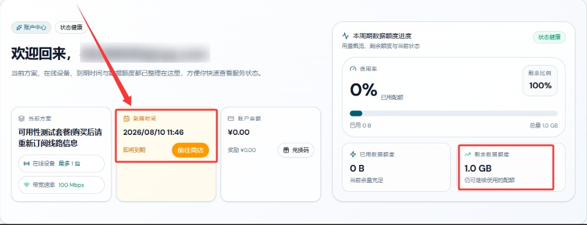

🇨🇳 [中文](README.md) | 🇺🇸 English | 🇷🇺 [Русский](README_RU.md) | 🇮🇷 [فارسی](README_FA.md)

# AckNetwork VPN Official Website (Updated November 4, 2026)

Official AckNetwork VPN Website<br>
Latest URL: [acknet.co](https://to.iix.im/ack01)<br>
Official URL: [acknet.co](https://to.iix.im/ack01)<br>

Best VPN Recommendations and Server List for 2026: [https://github.com/jdnei/JiChangTuiJian](https://github.com/jdnei/JiChangTuiJian)<br>

## Telegram VPN Deals & Community #AD
[VPN Giveaways](https://331024.de/archives/choujiang) | [VPN Chat Group](https://331024.de/archives/choujiang) | [VPN Trial Group](https://331024.de/archives/choujiang)<br>

[https://331024.de/archives/choujiang](https://331024.de/archives/choujiang)

## Invitation Code
`Register with this invitation code to receive a 1 GB trial plan. The provider may discontinue this promotion at any time.`

```bash
PC0U3XO8
```

<br>

## Promo Codes / Discount Codes
`15% OFF recurring plans | 10% OFF pay-as-you-go plans | Valid until October 10 (Year Not Specified)`

```bash
ACKCM85
```

```bash
ACKCN90
```

## Overview
AckNetwork VPN is a VPN service focused on providing stable connections and high-speed internet access.

Through optimized network routes and intelligent server scheduling, the service delivers a smooth, convenient, and reliable cross-platform internet experience.

## Advantages
AckNetwork VPN emphasizes network stability, connection speed, and everyday usability.

By combining intelligent routing with server optimization, the service aims to reduce network latency and improve connection performance.

AckNetwork supports multiple platforms and devices, offering straightforward configuration and convenient operation.

It is suitable for various activities, including everyday web browsing, video streaming, entertainment, remote work, and general internet access.

## Pricing Plans

| Plan | Starting Price | Data Allowance | Speed | Devices | Billing Cycle | Regions / Features |
| --- | --- | --- | --- | --- | --- | --- |
| High-Speed Enjoyment | From ¥16.00 | 100 GB | Up to 100 Mbps (Peak Speed Not Guaranteed) | 3 | Recurring Plan; Monthly Reset Based on Order Date | Hong Kong, Taiwan, Japan, Singapore, United States, and other regions; intelligent multi-entry access and load balancing |
| Preferred Acceleration | From ¥29.00 | 200 GB | Up to 300 Mbps (Peak Speed Not Guaranteed) | 5 | Recurring Plan; Monthly Reset Based on Order Date | Hong Kong, Taiwan, Japan, Singapore, United States, and other regions; intelligent multi-entry access and load balancing |
| Ultimate Leap | From ¥58.00 | 500 GB | Up to 500 Mbps (Peak Speed Not Guaranteed) | 10 | Recurring Plan; Monthly Reset Based on Order Date | Hong Kong, Taiwan, Japan, Singapore, United States, and other regions; intelligent multi-entry access and load balancing |
| Boundless Ride | From ¥58.00 | 128 GB | Up to 1000 Mbps (Peak Speed Not Guaranteed) | 5 | Long-Term Validity; Expires When Data Is Exhausted; No Reset | Hong Kong, Taiwan, Japan, Singapore, United States, and other regions; intelligent multi-entry access and load balancing; data allowances from repeated purchases cannot be combined |

## 📊 Performance Tests & Analysis

#### 1. Evening Peak-Hour Speed Test


#### 2. Streaming Service Unblocking Report


#### 3. Entry and Exit Node Analysis

