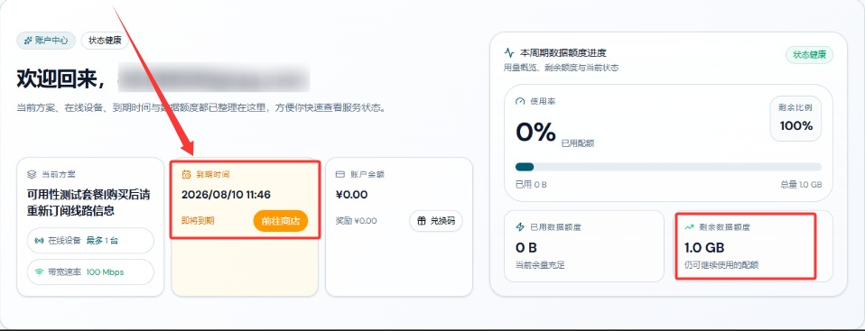

 🇨🇳 [中文](README.md) | 🇺🇸 [English](README_EN.md) | 🇷🇺 [Русский](README_RU.md) | 🇮🇷 فارسی

# وب‌سایت رسمی AckNetwork VPN(به‌روزرسانی 8 نوامبر 2026)
وب‌سایت رسمی AckNetwork VPN<br>
آخرین آدرس: [acknet.co](https://to.iix.im/ack01)<br>
آدرس رسمی: [acknet.co](https://to.iix.im/ack01)<br>

معرفی بهترین سرویس‌ها و سرورهای VPN در سال ۲۰۲۶: [https://github.com/jdnei/JiChangTuiJian](https://github.com/jdnei/JiChangTuiJian)<br>

## انجمن و پیشنهادهای ویژه VPN در تلگرام #AD
[قرعه‌کشی VPN](https://331024.de/archives/choujiang) | [گروه گفت‌وگوی VPN](https://331024.de/archives/choujiang) | [گروه آزمایش VPN](https://331024.de/archives/choujiang)<br>

[https://331024.de/archives/choujiang](https://331024.de/archives/choujiang)

## کد دعوت
`با ثبت‌نام از طریق این کد دعوت، یک طرح آزمایشی با ۱ گیگابایت ترافیک دریافت می‌کنید. ارائه‌دهنده ممکن است این پیشنهاد را در هر زمانی لغو کند.`

```bash
PC0U3XO8
```

<br>

## کدهای تخفیف
`۱۵٪ تخفیف برای طرح‌های دوره‌ای | ۱۰٪ تخفیف برای طرح‌های پرداخت بر اساس مصرف | معتبر تا ۱۰ اکتبر (سال مشخص نشده است)`

```bash
ACKCM85
```

```bash
ACKCN90
```

## معرفی
AckNetwork VPN یک سرویس VPN است که بر ارائه اتصالات پایدار و دسترسی پرسرعت به اینترنت تمرکز دارد.

این سرویس با استفاده از مسیرهای شبکه بهینه‌شده و مدیریت هوشمند سرورها، تجربه‌ای روان، راحت و قابل‌اعتماد از اینترنت را در پلتفرم‌های مختلف فراهم می‌کند.

## مزایا
AckNetwork VPN بر پایداری شبکه، سرعت اتصال و سهولت استفاده روزمره تأکید دارد.

این سرویس با ترکیب مسیریابی هوشمند و بهینه‌سازی سرورها تلاش می‌کند تأخیر شبکه را کاهش دهد و عملکرد اتصال را بهبود بخشد.

AckNetwork از پلتفرم‌ها و دستگاه‌های مختلف پشتیبانی می‌کند و تنظیمات ساده و استفاده آسانی دارد.

این سرویس برای فعالیت‌های متنوعی مانند مرور روزمره وب، تماشای ویدئوهای آنلاین، سرگرمی، دورکاری و استفاده عمومی از اینترنت مناسب است.

## طرح‌های اشتراک

| طرح | قیمت پایه | حجم ترافیک | سرعت | تعداد دستگاه | دوره و اعتبار | مناطق / ویژگی‌ها |
| --- | --- | --- | --- | --- | --- | --- |
| لذت سرعت بالا | از ¥16.00 | 100 GB | تا 100 Mbps (حداکثر سرعت تضمین‌شده نیست) | 3 | طرح دوره‌ای؛ بازنشانی ماهانه بر اساس تاریخ سفارش | هنگ‌کنگ، تایوان، ژاپن، سنگاپور، ایالات متحده آمریکا و سایر مناطق؛ دسترسی هوشمند از چند نقطه ورودی و متعادل‌سازی بار |
| شتاب‌دهی منتخب | از ¥29.00 | 200 GB | تا 300 Mbps (حداکثر سرعت تضمین‌شده نیست) | 5 | طرح دوره‌ای؛ بازنشانی ماهانه بر اساس تاریخ سفارش | هنگ‌کنگ، تایوان، ژاپن، سنگاپور، ایالات متحده آمریکا و سایر مناطق؛ دسترسی هوشمند از چند نقطه ورودی و متعادل‌سازی بار |
| جهش نهایی | از ¥58.00 | 500 GB | تا 500 Mbps (حداکثر سرعت تضمین‌شده نیست) | 10 | طرح دوره‌ای؛ بازنشانی ماهانه بر اساس تاریخ سفارش | هنگ‌کنگ، تایوان، ژاپن، سنگاپور، ایالات متحده آمریکا و سایر مناطق؛ دسترسی هوشمند از چند نقطه ورودی و متعادل‌سازی بار |
| حرکت آزاد | از ¥58.00 | 128 GB | تا 1000 Mbps (حداکثر سرعت تضمین‌شده نیست) | 5 | اعتبار بلندمدت؛ پس از اتمام حجم ترافیک منقضی می‌شود؛ بدون بازنشانی | هنگ‌کنگ، تایوان، ژاپن، سنگاپور، ایالات متحده آمریکا و سایر مناطق؛ دسترسی هوشمند از چند نقطه ورودی و متعادل‌سازی بار؛ حجم خریدهای تکراری قابل تجمیع نیست |

## 📊 آزمایش عملکرد و تحلیل

#### 1. آزمایش سرعت در ساعات اوج مصرف شبانه


#### 2. گزارش رفع محدودیت سرویس‌های پخش آنلاین


#### 3. تحلیل سرورهای ورودی و خروجی

