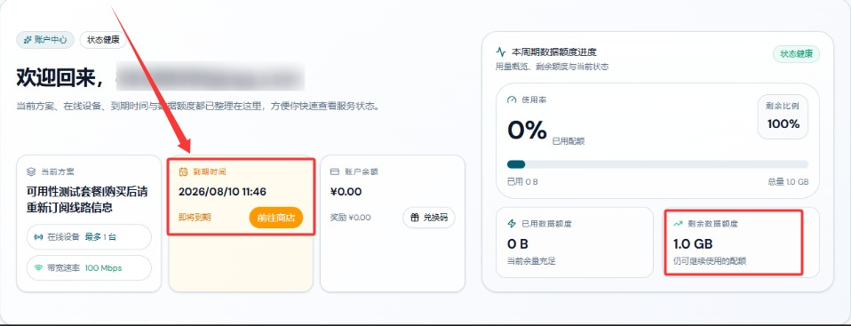

🇨🇳 [中文](README.md) | 🇺🇸 [English](README_EN.md) | 🇷🇺 Русский | 🇮🇷 [فارسی](README_FA.md)

# Официальный сайт AckNetwork VPN (обновлено 8 ноября 2026)

Официальный сайт AckNetwork VPN<br>
Актуальный адрес: [acknet.co](https://to.iix.im/ack01)<br>
Официальный адрес: [acknet.co](https://to.iix.im/ack01)<br>

Лучшие VPN-сервисы и серверы на 2026 год: [https://github.com/jdnei/JiChangTuiJian](https://github.com/jdnei/JiChangTuiJian)<br>

## Telegram: VPN-сообщество и специальные предложения #AD
[Розыгрыши VPN](https://331024.de/archives/choujiang) | [Чат о VPN](https://331024.de/archives/choujiang) | [Группа тестирования VPN](https://331024.de/archives/choujiang)<br>

[https://331024.de/archives/choujiang](https://331024.de/archives/choujiang)

## Пригласительный код
`При регистрации по этому пригласительному коду предоставляется пробный тариф с 1 ГБ трафика. Провайдер может отменить данную акцию в любое время.`

```bash
PC0U3XO8
```

<br>

## Промокоды / Коды скидок
`Скидка 15% на периодические тарифы | Скидка 10% на тарифы с оплатой по потреблению | Действует до 10 октября (год не указан)`

```bash
ACKCM85
```

```bash
ACKCN90
```

## Обзор
AckNetwork VPN — VPN-сервис, ориентированный на стабильное соединение и высокоскоростной доступ в интернет.

Благодаря оптимизированным сетевым маршрутам и интеллектуальному управлению серверами сервис обеспечивает плавную, удобную и надёжную работу интернета на различных платформах.

## Преимущества
AckNetwork VPN уделяет особое внимание стабильности сети, скорости соединения и удобству повседневного использования.

Сочетая интеллектуальную маршрутизацию и оптимизацию серверов, сервис стремится снизить задержку сети и улучшить качество соединения.

AckNetwork поддерживает различные платформы и устройства, предлагая простую настройку и удобное управление.

Сервис подходит для разных задач, включая повседневный просмотр веб-сайтов, потоковое видео, развлечения, удалённую работу и обычный доступ в интернет.

## Тарифные планы

| Тариф | Начальная цена | Трафик | Скорость | Устройства | Период и срок действия | Регионы / Возможности |
| --- | --- | --- | --- | --- | --- | --- |
| Высокоскоростное удовольствие | От ¥16.00 | 100 ГБ | До 100 Мбит/с (пиковая скорость не гарантируется) | 3 | Периодический тариф; ежемесячное обновление в дату заказа | Гонконг, Тайвань, Япония, Сингапур, США и другие регионы; интеллектуальный доступ через несколько точек входа и балансировка нагрузки |
| Оптимальное ускорение | От ¥29.00 | 200 ГБ | До 300 Мбит/с (пиковая скорость не гарантируется) | 5 | Периодический тариф; ежемесячное обновление в дату заказа | Гонконг, Тайвань, Япония, Сингапур, США и другие регионы; интеллектуальный доступ через несколько точек входа и балансировка нагрузки |
| Максимальный рывок | От ¥58.00 | 500 ГБ | До 500 Мбит/с (пиковая скорость не гарантируется) | 10 | Периодический тариф; ежемесячное обновление в дату заказа | Гонконг, Тайвань, Япония, Сингапур, США и другие регионы; интеллектуальный доступ через несколько точек входа и балансировка нагрузки |
| Свободное движение | От ¥58.00 | 128 ГБ | До 1000 Мбит/с (пиковая скорость не гарантируется) | 5 | Длительный срок действия; прекращается после исчерпания трафика; без обновления | Гонконг, Тайвань, Япония, Сингапур, США и другие регионы; интеллектуальный доступ через несколько точек входа и балансировка нагрузки; трафик повторных покупок не суммируется |

## 📊 Тесты производительности и анализ

#### 1. Тест скорости в вечерние часы пик


#### 2. Отчёт о разблокировке стриминговых сервисов


#### 3. Анализ входных и выходных узлов

